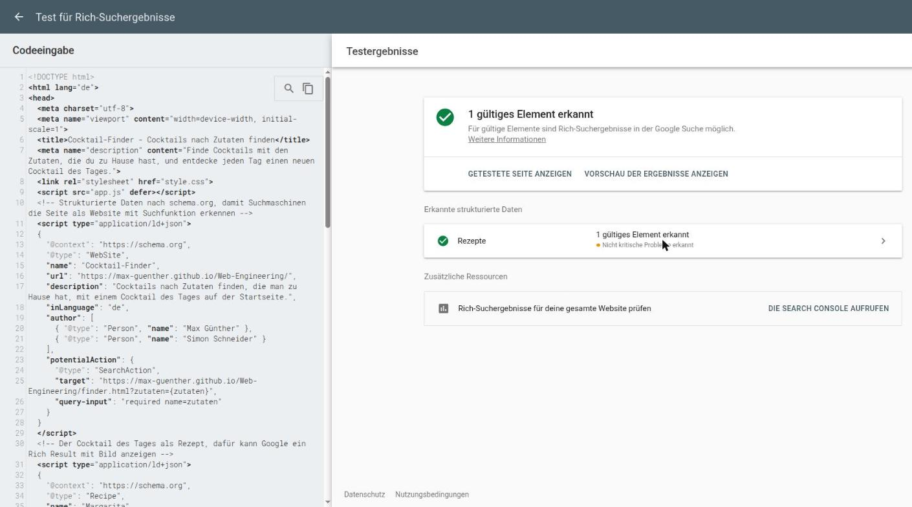

# Cocktail-Finder

Der Cocktail-Finder zeigt dir, welche Cocktails du mit den Zutaten mixen kannst, die du gerade zu Hause hast, auch mit mehreren Zutaten gleichzeitig. Dazu gibt es jeden Tag einen Cocktail des Tages, der für alle Besucher derselbe ist.

**Live:** folgt (GitHub Pages)
**Team:** Max Günther, Simon Schneider

## Was die App kann

- Cocktails nach Zutaten finden, die man zu Hause hat (auch mehrere gleichzeitig)
- Filtern nach alkoholisch/alkoholfrei und Kategorie, sortieren nach Name oder Anzahl der Zutaten
- Cocktail des Tages auf der Startseite, für alle Besucher am selben Tag derselbe

## Warum diese Idee

Fünf Ideen standen zur Auswahl, genommen haben wir den Cocktail-Finder: Die Zutatensuche ist von Natur aus ein Formular, und weil die API sie mit dem Test-Key nicht kann, müssen wir das Filtern selbst lösen.

- **Erdbeben-Radar:** Außer Mindeststärke und Zeitraum gibt es nichts einzugeben, ein Formular mit Validierung wäre also nur aufgesetzt.
- **Mini-Pokédex:** Die Listen-Anfrage liefert nur Name und Link, für Bild und Typ bräuchte jedes der 151 Pokémon eine eigene Anfrage, also 152 Requests beim Start.
- **Serien-Watchlist:** Der Kern der App ist die eigene Liste im `localStorage`, und die `summary`-Texte von TVmaze enthalten HTML, das wir erst gegen XSS absichern müssten.
- **Raketenstart-Countdown:** Ohne Key erlaubt Launch Library 2 nur 15 Anfragen pro Stunde, die sind beim Entwickeln mit Live Server nach ein paar Reloads weg.

## Datenquelle

[TheCocktailDB](https://www.thecocktaildb.com/api.php) mit dem öffentlichen Test-Key `1`.

Der Zutaten-Filter (`filter.php?i=`) liefert mit dem Test-Key nur einen Treffer. Deshalb lädt die App alle Cocktails über `search.php?f=a` bis `z` und `0` bis `9` (rund 440 Stück mit allen Zutaten) und filtert sie im Browser. Genutzt werden vor allem `strDrink`, `strDrinkThumb`, `strAlcoholic`, `strCategory`, `strIngredient1–15`, `strMeasure1–15` und `strInstructionsDE`.

## Lokal starten

```bash
npm install     # einmalig, holt Vite und Tailwind
npm run dev     # Dev-Server auf http://localhost:5173
npm run build   # fertige Seite nach dist/
npm run preview # dist/ lokal ansehen
```

Live Server reicht nicht mehr, weil die Tailwind-Klassen erst durch Vite zu CSS werden.

## Technik

- **Mehrere HTML-Seiten statt Single-Page:** Start, Finder und Über haben unterschiedliche Aufgaben, und jede Seite bekommt so einen eigenen Titel und eine eigene URL.
- **Formular ohne JavaScript:** `required`, `minlength` und `pattern` prüft der Browser selbst. `method="get"` legt die Eingaben in die URL, dort kann sie später das JavaScript auslesen.
- **Suche im Browser statt per API:** `filter.php?i=` liefert mit dem Test-Key nur einen Treffer, also laden wir alle Cocktails und filtern selbst (siehe Datenquelle).
- **`robots.txt`, `sitemap.xml`, `llms.txt` und JSON-LD:** Damit Suchmaschinen und KI-Crawler wissen, welche Seiten es gibt und worum es geht.

## KI-Log

| Werkzeug | Wofür ich es benutzt habe |
| --- | --- |
| Claude | Ideenfindung: mir fünf Projektideen mit passender öffentlicher API vorschlagen lassen (Blatt 1, Teil B) |
| Claude | Die vorgeschlagenen APIs antesten lassen, ob sie ohne Key und direkt aus dem Browser funktionieren |
| Claude | Blatt 2: HTML auf Semantik prüfen lassen und Lighthouse-Meldungen erklären lassen |
| Claude | Blatt 2: Gramatik und Rechtschreibungsprüfung |
| Claude | Blatt 3: Gramatik und Rechtschreibungsprüfung |
| Claude | Blatt 4: Gramatik und Rechtschreibungsprüfung, Fehler mit Node 18 erklären lassen |


**Ein Fall, in dem KI geholfen hat:** Bevor ich mich auf den Cocktail-Finder festgelegt habe, habe ich die API gründlich testen lassen. Dabei kam heraus, dass `filter.php?i=Gin` mit dem Test-Key immer nur einen einzigen Cocktail liefert. Daraufhin habe ich das Konzept umgestellt: Alle Cocktails werden über `search.php?f=` geladen und im Browser gefiltert. Dadurch geht jetzt sogar die Suche nach mehreren Zutaten.

**Ein Fall, in dem KI falsch lag:** In der ersten Ideenliste stand beim Cocktail-Finder, der Zutaten-Filter liefere Name, Bild und ID und könne nur eine Zutat auf einmal. Das klang plausibel, stimmte aber nicht: Beim genaueren Nachtesten kam pro Zutat immer nur ein Treffer zurück. Seitdem verlasse ich mich bei API-Aussagen nicht auf die Beschreibung, sondern rufe die URL selbst auf und schaue mir die Antwort an.

## Übungsblätter

Was die Blätter ausdrücklich in der README sehen wollen, steht hier, nach Blatt sortiert.

### Blatt 1 · Setup und erster Start

Projektname und Team stehen oben, die Begründung der verworfenen Ideen unter „Warum diese Idee“.

### Blatt 2 · Das Gerüst

- Drei Seiten (`index.html`, `finder.html`, `ueber.html`), jede mit `header`/`nav`, `main`, `footer` und genau einem `h1`
- Suchformular in `finder.html`: Pflichtfeld mit `minlength` und `pattern`, dazu Radio-Buttons, Zahlenfeld und Auswahlliste, ohne JavaScript
- Lighthouse Accessibility: 100 auf allen drei Seiten
- `robots.txt` und `sitemap.xml` im Wurzelverzeichnis

**Bonus, maschinenlesbar:** Im `head` der Startseite stehen zwei JSON-LD-Blöcke: `WebSite` mit `SearchAction` für die Seite selbst und `Recipe` für den Cocktail des Tages. Dazu liegt ein `llms.txt` im Wurzelverzeichnis.

Den ersten Test mit nur dem `WebSite`-Block hat der Rich Results Test mit „Keine Elemente erkannt“ beantwortet. Das JSON-LD war gültig, aber Google zeigt für `WebSite` kein Rich Result mehr an. Mit dem `Recipe`-Block erkennt der Test ein gültiges Element. Die 14 nicht kritischen Hinweise betreffen optionale Felder wie Bewertung, Zubereitungszeit und Video.



**Verständnisfragen**

1. *Warum `<button>` statt `<div onclick="…">`?* Ein `button` ist von selbst per Tab erreichbar und löst mit Enter und Leertaste aus, ein `div` bekommt weder Fokus noch Tastenereignisse. Außerdem sagt der Screenreader „Schaltfläche“ an, bei einem `div` hört man nur den Text und weiß nicht, dass man darauf klicken kann.
2. *Wofür ist `name` da?* `name` ist der Schlüssel, unter dem der Wert beim Absenden übertragen wird, bei uns `?zutaten=Gin`. Fehlt es, wird das Feld ohne jede Fehlermeldung einfach nicht mitgeschickt. Bei Radio-Buttons sorgt der gleiche `name` außerdem dafür, dass nur einer ausgewählt sein kann.
3. *Zwei `h1` auf einer Seite: wen stört das?* Screenreader-Nutzer, die sich über die Überschriften einen Überblick verschaffen: Zwei `h1` sind zwei Hauptthemen, und man weiß nicht, worum es auf der Seite geht. Suchmaschinen stört es auch, weil das `h1` ein starkes Signal für das Thema ist. Der Browser zeigt beides problemlos an, sichtbar geht also nichts kaputt.

### Blatt 3 · Eigenes CSS

- Ein Stylesheet für alle drei Seiten. Farben, Abstände, Radius und die drei Schriftgrößen stehen als Variablen in `:root`, ändert man `--akzent`, ändern sich Navigation, Überschriften, Button, Badge und Fokusrahmen mit.
- Navigation mit `:hover` und einem gestalteten `:focus-visible`-Rahmen, die aktuelle Seite ist über `aria-current` hervorgehoben.
- Abschnitte als Karten mit `padding`, `border-radius` und `gap`, Textbreite auf `65ch` begrenzt. Bei 360 px scrollt nichts seitlich.
- Der Header klebt oben (`position: sticky`), das Badge „Heute“ sitzt in der Ecke der Karte vom Cocktail des Tages (`relative` an der Karte, `absolute` am Badge).

**Kollision:** `nav a` setzt die Linkfarbe auf `--text`, `nav a[aria-current="page"]` setzt sie für die aktuelle Seite auf `--bg` (helle Schrift auf der Akzentfläche).
In den DevTools ist beim aktiven Link das `color` von `nav a` durchgestrichen. Es gewinnt `nav a[aria-current="page"]` mit Spezifität (0,1,2) gegen (0,0,2).
Der Attributselektor zählt wie eine Klasse in der mittleren Spalte, deshalb würde die Regel auch gewinnen, wenn sie weiter oben stünde.

**Bonus, Dark Mode:** `@media (prefers-color-scheme: dark)` überschreibt nur die Farbvariablen in `:root`, der Rest des Stylesheets bleibt gleich.

**Verständnisfragen**

1. *`nav a { color: grey }` gegen `.aktiv { color: blue }`?* Blau gewinnt. `.aktiv` hat (0,1,0), `nav a` nur (0,0,2), und verglichen wird von links nach rechts: Eine Klasse schlägt beliebig viele Elementselektoren. Die Reihenfolge im Stylesheet spielt erst bei gleicher Spezifität eine Rolle.
2. *Warum `rem` statt `px`?* `rem` richtet sich nach der Schriftgröße des Wurzelelements, und die kann man im Browser einstellen. Wer schlecht sieht und dort 20 statt 16 px einstellt, bekommt mit `rem` überall größere Schrift, mit `px` bleibt sie fest.
3. *`z-index: 999` wirkt nicht?* Vermutlich ist das Element nicht positioniert: `z-index` greift nur bei `position` ungleich `static` (oder bei Flex- und Grid-Kindern). Der zweite häufige Grund ist ein Elternelement, das einen eigenen Stapelkontext mit niedrigerem `z-index` bildet. Dann zählt die 999 nur innerhalb dieses Elternelements.

### Blatt 4 · Layout mit Flexbox und Grid

- Der `main` verwendet Grid. Ab 768 px und 1280 px bekommt der Inhaltsbereich mehr Breite und Abstand, bleibt aber bewusst einspaltig, weil das für Text und Formulare übersichtlicher ist. Navigation, Formular, Radio-Auswahl und Footer nutzen Flexbox.
- Die Karte „Cocktail des Tages“ auf der Startseite ist auf Tailwind umgestellt, der Rest bleibt eigenes CSS. Die Farben kommen weiter aus unseren Variablen (`bg-(--akzent)`), deshalb funktioniert der Dark Mode auch in der Karte. Tailwind ist ohne Preflight eingebunden, weil dessen Reset sonst auf allen Seiten z. B. die Listenpunkte entfernt hätte.
- Navigation, Footer und Abschnittskarten werden auf allen Seiten konsistent gestaltet. Die gemeinsamen Werte stehen zentral in `style.css`: Der Abstand heißt `--abstand`, der Radius `--radius` und die Farben heißen `--bg`, `--text`, `--akzent`, `--flaeche` und `--rand`. `nav` und `footer` kommen auf `index.html`, `finder.html` und `ueber.html` vor, `main section` wird auf den Inhaltsseiten mehrfach als Karte verwendet.
- Das Projekt läuft jetzt mit npm und Vite. `npm run build` baut alle drei Seiten nach `dist/`, `node_modules/` und `dist/` stehen in der `.gitignore`. `robots.txt`, `sitemap.xml` und `llms.txt` liegen in `public/`, Vite kopiert sie unverändert nach `dist/`.

**Eigenes CSS gegen Tailwind** (Karte und Badge, vorher in `style.css`):

| Vorher (eigenes CSS) | Tailwind |
| --- | --- |
| `position: relative` / `absolute` | `relative` / `absolute` |
| `padding: var(--abstand)` (1rem) | `p-4` |
| `top` und `right: var(--abstand)` | `top-4 right-4` |
| `border-radius: var(--radius)` (12px) | `rounded-xl` |
| `background: var(--bg)` | `bg-(--bg)` |
| `color: var(--bg)` | `text-(--bg)` |
| `padding: .125rem .625rem` | `py-0.5 px-2.5` |
| `font-size: var(--schrift-klein)` mit Zeilenhöhe 1.5 | `text-sm/normal` |
| `font-weight: 700` | `font-bold` |
| `padding-right: 4.5rem` am `h3` | `pr-18` |
| `margin-bottom: 0` am letzten Absatz | `mb-0` |

Eine Tailwind-Stufe ist `0.25rem`, `p-4` sind also 1rem. Die Karte sieht vorher und nachher gleich aus, das habe ich mit Screenshots bei 360 und 1280 px verglichen.

**Bonus, Vite mit Tailwind-Build:** Statt Play CDN baut das Tailwind-Plugin für Vite das CSS. In `dist/assets/` liegt danach eine einzige CSS-Datei mit 4,1 kB (1,5 kB gzip), davon sind nur rund 1,4 kB Tailwind. Sie bleibt so klein, weil Tailwind beim Build die Dateien des Projekts nach Klassennamen durchsucht und nur für die gefundenen Klassen CSS erzeugt. Die anderen tausenden Klassen existieren nur als Möglichkeit. Weil Tailwind dabei nur nach Wörtern sucht, landen auch `static` und `sticky` in der Datei: Die beiden Wörter stehen in dieser README.

Tailwind ist auf 4.1 festgelegt, weil die Versionen ab 4.2 Node 20 voraussetzen und bei uns noch Node 18 läuft.

**Verständnisfragen**

1. *Was bedeutet die Einheit `fr` in `grid-template-columns: 1fr 3fr`?* `fr` steht für fraction. Der verfügbare Platz wird dabei entsprechend den angegebenen Anteilen aufgeteilt. In diesem Beispiel wird er in vier gleich große Teile geteilt. Die erste Spalte erhält ein Viertel und die zweite drei Viertel des verfügbaren Platzes.
2. *Was macht `npm run build` mit dem Projektordner?* Es startet `vite build` aus den `scripts` in `package.json`. Vite liest die drei HTML-Seiten, bündelt CSS und JavaScript, lässt Tailwind nur die benutzten Klassen erzeugen, minifiziert alles und hängt einen Hash an die Dateinamen (`app-CVLrnnRM.css`), damit der Browser nach einer Änderung nicht die alte Version aus dem Cache nimmt. Das Ergebnis steht in `dist/`. Auf den Server kommt nur `dist/`: `node_modules/`, `package.json` und die Quelldateien braucht der Browser nicht, und `node_modules/` allein ist schon viel größer als die ganze Seite.
3. *Warum `node_modules/` nicht ins Repo, `package-lock.json` aber schon?* `node_modules/` lässt sich mit `npm install` jederzeit neu erzeugen, ist groß und enthält teilweise Dateien für das jeweilige Betriebssystem, bei Tailwind zum Beispiel ein eigenes Programm für Linux. `package-lock.json` hält fest, welche Version jedes Pakets genau installiert wurde. Ohne die Datei würde `"^6.0.0"` bei Simon vielleicht eine andere Vite-Version installieren als bei mir.